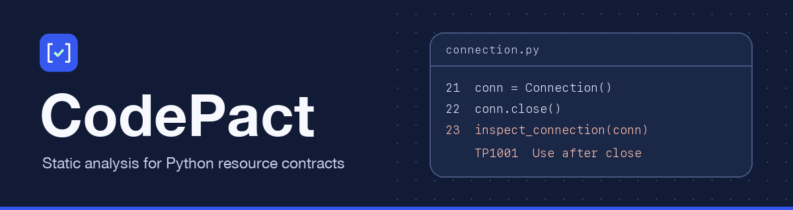

# 

**Find Python resource bugs before runtime.** Declare which method closes a
resource and which APIs own or borrow it. CodePact reads Python source and
reports supported use-after-close, missed cleanup, and discarded must-use
results. It checks your code without importing or running it.

[](https://github.com/eddiethedean/codepact/actions/workflows/quality.yml)
[](https://pypi.org/project/codepact/)
[](https://pypi.org/project/codepact-cli/)
[](https://github.com/eddiethedean/codepact/blob/main/LICENSE)

[Documentation](https://github.com/eddiethedean/codepact/blob/main/docs/README.md) ·
[Install options](https://github.com/eddiethedean/codepact/blob/main/docs/install.md) ·
[Rule catalog](https://github.com/eddiethedean/codepact/blob/main/docs/rules.md) ·
[Roadmap](https://github.com/eddiethedean/codepact/blob/main/ROADMAP.md)

| Version | How to try it |
| --- | --- |
| **0.4.0 · Published preview** | Install from PyPI or crates.io. Includes lifecycle checking, must-use results, and CI reporting. [Published artifacts and qualification](https://github.com/eddiethedean/codepact/blob/main/docs/availability.md) |
| **0.5.0 · Development candidate** | Build from source to try explicit moves, lexical borrows, and a bounded `asyncio.TaskGroup` model. [Experimental ownership](https://github.com/eddiethedean/codepact/blob/main/docs/ownership.md) |

## Quick start

In an existing uv project, install the helper package and its matching CLI.

```sh
uv add codepact==0.4.0
mkdir -p demo
```

Save this as `demo/connection.py`.

```python
"""Small lifecycle example for `codepact check --root examples`."""

from codepact import resource
from codepact.rust import Borrowed


@resource(closed_by="close")
class Connection:
    def status(self) -> str:
        return "ready"

    def close(self) -> None:
        pass


def inspect_connection(conn: Borrowed[Connection]) -> str:
    return conn.status()


conn = Connection()
inspect_connection(conn)
conn.close()
inspect_connection(conn)  # TP1001 at this call; close is the related location.
```

```sh
uv run --locked codepact check --root demo
```

```text
connection.py:23:1: error TP1001: Borrowed call requires an open resource
  certainty: definite
  trust: declared-unverified
  repair: Keep the use before close, or guard it with a lifecycle check.
  related: connection.py:22:1
1 diagnostics; 1 actionable; 0 suppressed; 0 rule-disabled; 1 returned
```

The check exits `1`. Remove the call after `conn.close()` and rerun the same
command to get exit `0`. The example uses a stub close method. CodePact checks
the declared state transition, while your implementation supplies the actual
cleanup. [Quick start and report walkthrough](https://github.com/eddiethedean/codepact/blob/main/docs/quickstart.md)

## What you can check

| Declare | CodePact checks |
| --- | --- |
| `@resource(closed_by="close")` | Supported use after close and conflicting lifecycle metadata |
| `Owned[T]` | Cleanup duties across modeled exits and open resources at ownership handoff |
| `Borrowed[T]` | Closing a resource through a shared view |
| `@must_use` or `MustUse[T]` | Bare discarded calls to marked synchronous functions |

The helpers use `typing.Annotated`, so ordinary types remain available to mypy
and Pyright. The checker follows supported branches, aliases, calls, exceptions,
and cleanup paths. Check reports include primary and related source locations,
certainty, and coverage. [Contract syntax](https://github.com/eddiethedean/codepact/blob/main/docs/contracts.md) ·
[Supported syntax](https://github.com/eddiethedean/codepact/blob/main/docs/supported-syntax.md)

## Run in CI

Start with a narrow source root. Use strict mode when incomplete coverage
should fail the job, and retain the JSON report alongside the exit status.

```sh
uv run --locked codepact check --root src --mode strict --json > codepact-report.json
```

| Exit | Meaning |
| --- | --- |
| `0` | The completed report passed the selected policy |
| `1` | The completed report failed policy |
| `2` | The invocation or check failed |

Advisory mode can pass with incomplete coverage. The coverage field describes
which parts of the program the checker could analyze. Teams can configure rule
severity, review a baseline, and record line-level exceptions with a reason.
[Adoption guide](https://github.com/eddiethedean/codepact/blob/main/docs/adopting.md) ·
[CI examples](https://github.com/eddiethedean/codepact/blob/main/docs/ci-reporting.md)

## Compatibility

The helper package runs on Python 3.11 and later, with CI on CPython 3.11–3.14.
The analyzer supports Python **3.11–3.13 source targets**. Native CLI wheels are
available for Linux, macOS, and Windows on x86-64 and ARM64. Building from
source requires Rust 1.96 or later and a linker.
[Platform matrix](https://github.com/eddiethedean/codepact/blob/main/docs/availability.md) ·
[Standalone CLI and Rust library](https://github.com/eddiethedean/codepact/blob/main/docs/install.md)

## Contribute

Run `uv sync --locked` and `uv run --locked make check` after installing the
repository's pinned Cargo audit tools. The contributor guide lists the setup
and focused check targets.
[Contributing](https://github.com/eddiethedean/codepact/blob/main/CONTRIBUTING.md) ·
[Build the docs](https://github.com/eddiethedean/codepact/blob/main/docs/documentation.md) ·
[MIT license](https://github.com/eddiethedean/codepact/blob/main/LICENSE)
