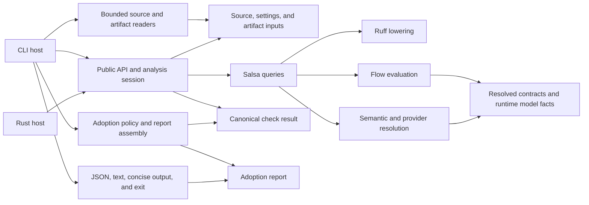

# CodePact SOLID refactor plan

Status: **Implemented.** Baseline: Phase 0.8 implementation at `5cb2cd1`.
This is an internal refactor track alongside the [release roadmap](../../ROADMAP.md).
The first slices support 0.9's reviewed library models, persistent duties, and
change review. Later slices support the additional runtime models and hosts
already scheduled in 0.10–0.12.

## Objective

Make a change to a model, a policy, or an input adapter local to the code that
owns that decision. Keep one analyzer for the CLI and Rust hosts. Preserve
supported behavior, coverage boundaries, incremental reuse, and the published
Rust crate and Python distributions. Carry deliberate semantic or compatibility
changes in their own reviewed changesets.

## Where the boundaries need work

| Area | Current seam | Target responsibility |
| --- | --- | --- |
| Rust API and sessions | `lib.rs` exposes several generations of check entry points. `AnalysisSession::run_check` prepares providers, synchronizes tracked inputs, runs analysis, and assembles evidence. | Public entry points translate to a shared internal request. Session code owns revisions, budgets, cancellation, and tracked input updates. Result assembly consumes the query outputs. |
| Frontend and semantic resolution | `frontend` already owns Ruff lowering. `semantic`, `semantic::project`, and `foundation::publication` all work with declaration and export identities. | The frontend produces lowered syntax and binding events. Semantic resolution owns canonical identity and export summaries. Publication applies its public-name, artifact, and trust requirements to those facts. |
| Flow and runtime models | `flow::expressions` and `flow::execution` call model-specific branches. `State` contains mutable state for bindings, ownership, protocols, and coroutines with a coupled merge. | Core evaluation owns order, binding, control flow, and budget handling. Each model owns its applicability and protocol transitions. The flow engine owns applying effects and joining paths. |
| Provider artifacts | `cli::providers` uses helpers from `cli::publications` for installed metadata. `foundation::publication` handles manifest format, source export normalization, and selection. | Filesystem and ZIP adapters provide bounded artifact inputs. Shared artifact validation owns metadata and digest rules. Semantic selection owns applicability, provenance, and precedence. |
| Adoption and CLI | `adoption::build_report` validates the result, fingerprints inputs, applies policy, and builds the envelope. `cli::run` routes commands and manages input, execution, and output. | Separate command orchestration, policy decisions, report identity, and serialization. Keep public report types and rendering formats stable. |
| Python helpers | `contracts.py`, `outcomes.py`, and `rust.py` already separate metadata, values, and exports. The top-level module owns decorators as well as the public facade. | Keep these boundaries. Extract shared private declaration validation only where existing repetition or new requirements justify it. |
| Tooling and delivery | Package qualification, artifact replay, release smoke checks, and docs validation span multiple scripts and workflow jobs. Both package and release smoke tooling read the locked dependency version. | Share identical mechanics across scripts. Keep conformance, semantic oracles, artifact qualification, and publication decisions separately reviewable. |

## How to apply SOLID here

| Principle | Design rule and review question |
| --- | --- |
| **Single responsibility** | Give each module one reason to change. A new report field belongs in report assembly. A changed runtime effect belongs to the model and its qualification. |
| **Open/closed** | Add a reviewed model by adding its effect logic, an explicit entry in the applicable model dispatch, and its conformance evidence. The evaluator should gain branches only when the Python operation itself requires a new kind of evaluation or exit. |
| **Liskov substitution** | Two hosts given equivalent inputs must agree on canonical analysis. Fresh and reused sessions must agree after each edit. Archive and installed readers must agree on shared facts while enforcing their respective layouts and trust requirements. |
| **Interface segregation** | Provide each caller the data it needs. Flow receives resolved model facts, policy receives a completed canonical result, and rendering receives a report. Keep request data, mutable analysis state, and report transport distinct. |
| **Dependency inversion** | Pass source snapshots, selected artifacts, target settings, and model evidence into analysis as data. Derive file paths, read archives, and write stdout in the adapters. Use concrete Rust structs and enums for bounded domains and introduce traits only at a boundary with multiple real implementations. |

Start with internal modules in the existing Rust crate. Prefer small functions
and explicit calls. Reuse a shared abstraction once two concrete cases
demonstrate the same contract and failure semantics.

## Target dependency direction

Arrows point from a caller or consumer to its dependency. The frontend and
resolver feed flow through tracked queries and stable in-memory summaries.
The Python helper package is independent at import time. The analyzer reads
supported helper declarations as source syntax.

## Delivery sequence

Each slice should be independently reviewable and revertible. Move code and
retain its observables first, then improve representations in smaller changes.
Use the release roadmap to prioritize a seam when the next feature needs it.

### 0. Capture the reference behavior

Record the exact implementation revision, fixtures, toolchain, and comparison
environment. Capture representative canonical and CLI reports for inspection,
source-only analysis, ownership, advanced contracts, and foundations. Include
the policy and settings variants, baseline matching with the same engine
version, and both valid and unsupported provider inputs. Keep output ordering,
fingerprints, scope, coverage, and diagnostics in the comparison.

Capture paired measurements for cold requests, unchanged requests, local edits,
provider edits, and peak memory. Use the current
[Phase 0.8 capture](../../scripts/capture_phase08_performance.py) and
[query event tests](../../crates/codepact/src/db.rs) as starting points. Record
which differences are environmental, such as absolute checkout paths, before
comparing reports. Keep model identifiers, scope, and diagnostic evidence in
the comparison.

### 1. Separate command handling and adoption policy

1. Keep argument parsing in `cli::args`. Route inspection, checking, baseline
   updates, metadata, and publication through command-specific entry points.
   Keep the inspect and check input rules distinct. Let one CLI boundary
   translate completed outcomes and invocation failures into output and status.
2. Extract the pure decision part of `adoption::build_report` in stages.
   Establish typed inputs for suppression and baseline decisions, then separate
   diagnostic disposition and counts from report identity and bounded rendering.
   Give `baseline.rs` the same fingerprint and eligibility rules where the
   semantics match. Keep baseline file writes and replacement checks at the
   existing I/O boundary.
3. Keep public functions, return types, and report field names as compatibility
   facades. Verify exit codes 0/1/2, suppressed or disabled audit entries,
   truncated detail, stream failures, and semantic/policy/model fingerprints.
   Use the existing [CLI qualification tests](../../crates/codepact/tests/release_qualification.rs)
   and [schema fixture checker](../../scripts/check_schema_fixtures.py).

### 2. Separate artifact reading, publication, and model selection

1. Extract shared bounded reads and wheel metadata rules from the publication
   command into a CLI artifact module. Keep separate inputs for ZIP members and
   installed paths. Preserve each layout's existing `RECORD` handling,
   normalization, hash checks, path checks, limits, and failure behavior.
2. Divide `foundation::publication` along manifest encoding and validation,
   source-backed export discovery, and selected publication facts. Keep
   import resolution ahead of fact selection and make the winning identity
   explicit. Keep declared requirements, checked effects, reviewed project
   effects, and rejected effects distinguishable in evidence.
3. Put exact-version, lock, override, and runtime applicability decisions
   behind focused functions that accept explicit identities and facts.
   Feed the existing provider-selection query with equivalent inputs before
   changing tracking granularity. Compare equivalent installed and archive
   evidence using [Phase 0.8 artifact replay](../../scripts/check_phase08_artifacts.py).
   Retain negative controls for ambiguous or missing locks, stale manifests,
   changed source, native shadows, and local/earlier-root precedence.

### 3. Separate flow evaluation from state and model effects

1. Start with call preparation and argument binding. Route model and source
   operations through the existing binder where their semantics agree.
   Distinguish unrecognized operations, recognized operations with unavailable
   evidence, and applicable effects at the dispatch boundary. Preserve
   evaluation order, exceptions raised during binding, and the difference
   between an evaluated move and an accepted ownership transfer.
2. Make state mutation local to its domain. Group bindings and aliases,
   resource lifecycle and duties, protocol states, and scheduled work under
   focused operations. Keep the core merge explicit while extracting one
   domain at a time from `flow::state::merge`. Keep completion and pending
   raises attached to their paths, including timeout cancellation origin.
   Test cross-domain transitions at joins, handler entry, and finally exits.
3. Pilot the model interface with `builtins.open` and its known file context
   cleanup. Move Process and Pool transition decisions next. Model applicable
   success, typed failure, and unknown effects separately. Extract asyncio
   scheduling and joins last, preserving the difference between a stop
   request, completion, observation, and cleanup. Keep the dispatcher explicit
   until the operation families demonstrate a shared interface.
4. Run [Phase 0.3 exit-flow](../../crates/codepact/tests/phase03.rs),
   [Phase 0.8](../../crates/codepact/tests/phase08.rs), and
   [independent semantic properties](../../crates/codepact/tests/semantic_properties.rs).
   Re-run exact [runtime conformance](../../tests/conformance/runtime-models.json)
   when modeled transitions or prerequisites move. Preserve known successful,
   exceptional, cancelled, and unsupported paths, plus budget recovery.

### 4. Tighten frontend, resolver, and session interfaces

1. Preserve the frontend's lowered representation, identifier tables, and
   source offsets. Compare the declaration/export identity paths used by
   semantic resolution and provider publication. Consolidate the common
   identity operations once the parity cases cover rebinding, aliasing,
   submodule imports, and public versus canonical names. Keep publication
   trust and export eligibility decisions with the publication layer.
2. Split session input synchronization, preparation of provider/model inputs,
   query invocation, and result assembly into explicit steps. Keep cancellation
   scoped to the request and keep publication of results tied to the revision.
   Relocate session-only test groups into private test modules as needed.
3. Qualify query dependencies separately from result parity. Preserve reuse
   on no-op and unrelated edits and targeted invalidation on provider changes,
   exported-fact edits, moved spans, grammar changes, and lost applicability.
   Verify recovery after cancellation, input limits, and cache reset. Keep
   [analyzer migration guarantees](analyzer-migration.md) as the reference for
   frontend and query behavior.

### 5. Simplify Python and delivery tooling

1. Keep public Python modules, exports, signatures, decorator identity,
   `Annotated` metadata, and exception behavior. Retain `py.typed` and the
   lazy boundary between helpers and the native CLI. Deduplicate private
   validation only where exception messages, ordering, and metadata remain
   equivalent. Use the existing mypy, Pyright, and Basedpyright fixtures on
   source and installed packages.
2. Start tooling consolidation with locked-version lookup and other identical
   helpers. Separate artifact inventory and metadata validation from clean
   install execution and receipt writing. Keep the conformance probe oracle,
   release evidence checks, and packaging checks independent. Preserve
   CLI arguments, exit codes, receipt formats, and isolation from checkout
   imports during installed-package checks.
3. Keep report validation version-specific. The reference
   [report consumer](../../scripts/consume_check_report.py) currently selects
   completed report schema 3, while foundations checks emit schema 4.
   Track schema 4 consumer support as a separate behavior change with
   fail-closed checks for stale snapshots and provider evidence. Reuse the
   schema registry setup where applicable during the mechanical refactor.
4. Keep workflow job names, release artifact inventory, exact runtime pins,
   and publish controls stable. Run the documented commands against checkout
   wheels and validate the independent Cargo install. Record post-refactor
   evidence in the existing qualification format.

## Acceptance and sequencing decisions

| Risk | Evidence needed before merging the affected slice |
| --- | --- |
| Observable behavior drift | Equivalent API, CLI, and schema results on the reference corpus. Review substantive differences separately, including path identity, diagnostic order, settings defaults, and baseline compatibility. |
| Loss of coverage or soundness | Preserve independently expected findings and boundaries, including no target execution, failed provider or model selection, and work-limit exhaustion. Keep a control for each moved transition. |
| Broader invalidation or cost | Compare query events as well as outputs. Inspect cold, unchanged, edited, and provider-upgrade measurements. Investigate repeatable regressions using the [existing performance guidance](testing.md#performance). |
| Packaging or release regressions | Run the relevant `make check` targets locally and confirm the `Required quality` workflow for each PR. When package boundaries or tooling change, replay clean installs, validate sdists and Cargo packaging, and preserve the eight-platform release matrix. |
| Excess abstraction | Show a representative change that has become local, such as adding a model or changing a renderer. Keep the compatibility facade and remove forwarding layers that carry no behavior or invariant. |

Start with the reference capture and the smallest policy extraction. Prioritize
artifact selection and the file model pilot before expanding the reviewed model
catalog. The underlying 0.9 feature work can take the seams it needs as they
land. Save wider state regrouping, query-key changes, and packaging changes for
separate PRs with their own evidence. The refactor is complete when each area
has a clear owner, a tested boundary, and a comparison showing preserved
behavior and acceptable operational cost.

## Implementation evidence

The reference build used the exact `5cb2cd1` source snapshot with Rust 1.96.0.
The CLI comparison used identical paths and configuration for both binaries.
It matched stdout, stderr, and status byte for byte across 211 cases, including
the synthetic projects on all three grammar targets, report schemas 0, 3, and
4, settings schemas 2 and 3, and accepted and rejected provider inputs.
Baseline creation also produced identical bytes.

An independent Rust API caller compared six canonical results, including
inspection, legacy checking, ownership, and foundations results. The
foundations snapshots include an application edit and a provider edit.
Fresh and reused results matched, and returned session revisions agreed
with the reference. The workspace suite independently checks no-op reuse,
targeted invalidation, cancellation recovery, and flow properties.

The local `make check` suite passed, including 671 Rust tests, the Python
and typing checks, the dependency audit, Rust 1.96.0, and strict docs and
schema validation. The package checks built the helper and CLI distributions
from their source archives, tested isolated installs and provider artifacts,
and tested and installed the unpacked Rust crate.

The exact Linux x86-64 runtime probes passed on CPython 3.11.15, 3.12.13,
and 3.13.16, with 12, 12, and 33 probes respectively and zero skips.
The documentation examples passed against locally built 0.8.0 wheels.
The refactored release verifier also accepted the published 0.7.0 inventory
of eight native wheels, one helper wheel, and two source archives, retrievable
by their registry digests. The local release smoke now runs its CLI check
with an isolated Python interpreter so checkout package metadata cannot
shadow the wheel under test. The archived wheels passed that smoke on
macOS ARM64.

On macOS ARM64, 12 alternating process pairs per workload compared the
optimized state, exclusive access, executor, and installed manifest examples.
Median paired cold times decreased by 0.3–1.8% across the four workloads.
The largest median increase was 1.4% (1.8 µs) for an unrelated edit in
the installed manifest workload. Peak process RSS changed by about
−0.27 to +0.10 MiB across workloads.

Local transcripts and receipts are under `target/solid-reference/`. This
validation applies to the refactor worktree and its locally built artifacts.
