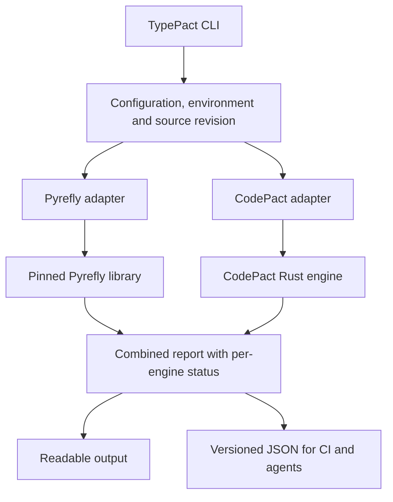

# TypePact — Type checking and behavioral contracts for Python

Status: **Planned**, 2026-11-07. The maintainer selected the product split and accepted the maintenance cost of embedding Pyrefly's unstable Rust library behind a pinned adapter. No combined implementation, package, workflow or qualification gate is complete. This plan supersedes the [earlier combined CLI proposal](codepact-pyrefly-cli.md), retaining its PF work and acceptance identifiers.

## Product definition

**CodePact — Behavioral contracts for Python.** CodePact owns the contract library and analyzer: qualified lifecycle checks and the current cleanup candidate, with ownership, borrowing, state, effects, must-use outcomes and structured task lifetimes as their core roadmap gates pass.

**TypePact — Type checking and behavioral contracts for Python.** TypePact combines upstream Pyrefly's ordinary Python type checking with CodePact's behavioral analysis in one installed command and report. It targets teams that want both checks without maintaining separate invocations and reporting integrations.

CodePact remains independently usable alongside any type checker. TypePact delegates general type semantics to Pyrefly and behavioral semantics to the same CodePact engine used by its standalone command. D002's one canonical contract engine applies to both products; TypePact composes two engines, not two implementations of contracts.

The first useful outcome is one command finding an ordinary type error and a supported resource error in the same project, followed by a check–edit–recheck that clears both. Core feature claims follow the embedded CodePact version; packaging them together adds no ownership or concurrency guarantee.

## First release scope

The first alpha supplies a combined batch CLI, readable diagnostics, versioned JSON, effective configuration inspection, reproducible wheels and source archives, and migration instructions for the historical TypePact packages. Run both engines by default. A project using only ordinary Python annotations can still receive Pyrefly findings; CodePact checks apply only where its qualified inference/models or explicit declarations establish them.

Watch mode, a combined language server, MCP delivery, automatic fixes and shared inference are later work. Existing CLI/JSON agent workflows can consume the first alpha. Do not delay the independent CodePact 0.3–0.9 sequence for this product.

## Installation and public names

Proposed names and versions are not available installation instructions:

| Surface | Planned contract |
| --- | --- |
| Main PyPI distribution | `typepact`, a pure Python installation/meta package |
| Binary PyPI distribution | `typepact-cli`, supplying native `typepact` / `typepact.exe` |
| Command | `typepact check` runs Pyrefly and CodePact |
| Python declarations | Continue importing `codepact`, `codepact.contracts` and `codepact.rust` |
| First combined candidate | Proposed `0.4.0a1`; confirm an unused version above historical releases before freezing it |
| Rust implementation | Proposed `crates/typepact/`, initially `publish = false` |
| Release lane | Proposed `release-typepact.yml`, `typepact-v0.4.0a1` tag, environment `pypi` |

Use `uv add --dev 'typepact==0.4.0a1'` or `uv tool install 'typepact-cli==0.4.0a1'` only after that candidate is published. The main package pins `typepact-cli` to its own version and `codepact` to the exact compatible core release. Do not restart at 0.1.0: the TypePact names already have published history. Version TypePact independently of CodePact and record all engine versions in each release.

The dependency direction is `typepact -> typepact-cli` and `typepact -> codepact -> codepact-cli`. The combined binary embeds both Rust engines and does not launch either standalone CLI. Retaining D015 means the full installation also downloads the standalone CodePact executable; accept and measure that cost initially. CLI-only installations omit the declaration helpers; projects importing them must install `codepact` in their own environment. A development dependency on TypePact does not replace a library's runtime dependency on the helpers it imports.

No compatibility `typepact` Python import namespace is planned. Contract definitions have one class/metadata identity under `codepact`. Co-installation with standalone `codepact` and `pyrefly` must preserve all three commands. Historical and new `typepact-cli` versions cannot coexist in one environment; use isolated environments when comparing them.

## Architecture and embedding decision



Embed Pyrefly rather than orchestrating two installed checkers. The maintainer accepts upstream API changes between versions. Pin an exact reviewed upstream release/commit and isolate all internal calls in the Pyrefly adapter; never follow a branch or upgrade implicitly. A lockfile is necessary but does not replace a complete source dependency record.

Upstream's [library source](https://github.com/facebook/pyrefly/blob/main/pyrefly/lib/lib.rs) explicitly warns that its interface can change in minor versions. Its [Cargo manifest](https://github.com/facebook/pyrefly/blob/main/pyrefly/Cargo.toml) exposes a library and repository-local crates. These moving references were inspected for planning; they are not a qualified revision or a registry-packaging guarantee.

PF01 must select entry points for source/configuration inputs, structured diagnostics, cancellation and environment discovery; prove a small in-memory fixture and a multi-file project; and record toolchain, dependency and source-build requirements. If a capability is unavailable, document the limitation before promising it. A CLI subprocess wrapper is a different design and requires an explicit amendment, not a silent fallback.

Keep each engine's AST, resolver, incremental database and IDs private. Initially analyze sequentially to bound resource use and make parity easier to establish; measure before introducing parallel engine execution. Do not feed Pyrefly-inferred types into CodePact to strengthen contract conclusions in the alpha. Such a bridge needs separate semantics, provenance and counterexamples later.

## Commands and configuration

Proposed alpha interface:

```text
typepact --version
typepact check [FILE...] [--root DIR] [--python-version VERSION] [--json]
typepact dump-config [--root DIR] [--json]
```

Use `[tool.typepact]` for orchestration settings, native `[tool.pyrefly]` or `pyrefly.toml` for type-checker policy, and CodePact's qualified configuration surface for contract policy. Do not invent new CodePact settings before its configuration work is implemented. Initial proposed orchestration keys are `root` and `python-version`; paths are relative to the declaring configuration file. Engine-specific policy stays native.

Wrapper flag precedence is explicit CLI value, then `[tool.typepact]`, then compatible engine configuration, then a documented qualified default. A common target overrides both engines; absent that override, reject conflicting targets instead of silently checking different Python versions. Other settings, including error policies, are resolved by the owning engine. `dump-config` shows origins, effective targets, engine configuration paths, interpreter/stub search paths, selected modes and file scopes, with no file writes.

[Pyrefly configuration documentation](https://pyrefly.org/en/docs/configuration/) distinguishes project and explicit-file modes, supports `pyrefly.toml` and `[tool.pyrefly]`, and describes synthesized settings for unconfigured projects. The adapter must qualify these behaviors at the pinned revision. In particular, TypePact must disclose the effective type-checking mode; it must not imply that a limited default enables every type rule. TypePact does not automatically write or migrate configuration.

Without FILE arguments, select the invocation root from `--root`, configured root, or the working directory. Use each engine's native project discovery and report differing checked/dependency scopes. Do not search above an explicitly selected root for wrapper configuration; reject an explicitly configured incompatible engine root. With FILE arguments, require root-contained inputs and preserve the dependencies each engine needs. CodePact currently scans its root even when filenames are supplied; unless a new core scope API is qualified, disclose that broader scan rather than claiming a changed-files-only check. Do not turn project mode into Pyrefly explicit-file mode merely to force matching file lists.

Qualify virtual environments, installed stubs, source roots, missing imports and supported Python targets. Respect configured interpreter discovery without importing application modules, evaluating decorators or running project hooks. Any interpreter probe is limited to documented environment discovery; expose an explicit interpreter/environment selection once the pinned API supports it. The supported target range is the tested intersection of the engines, distinct from the Python versions that can install the wheels.

## Consistent source and result contract

The host attributes each run to source, configuration and model fingerprints. Prefer shared immutable source inputs when the embedded APIs permit them. Otherwise instrument reads and validate all files/configuration read by either engine before and after analysis, including dependency discovery. Do not claim an immutable snapshot merely from matching top-level files. If same-revision input cannot be established, return an explicit failed/incomplete aggregate result with partial engine output; no clean combined success. PF01 must prove the selected strategy can observe the relevant reads.

Run both engines when one reports findings. After a recoverable engine error, still run the other when its inputs remain usable. A global invocation error or cancellation may prevent a run; mark the affected engine as not run or cancelled. Do not promise recovery from aborts, out-of-memory or other failures that cannot safely return a report. Hard process failure remains non-success and must never be converted to a clean result by a consumer.

The initial JSON schema is versioned independently of product versions and includes:

| Field group | Required meaning |
| --- | --- |
| Identity | Schema and TypePact versions, CodePact version/revision, exact Pyrefly version/revision |
| Inputs | Invocation root, source revision/fingerprints, effective target/configuration/model fingerprints |
| Engines | Separate completion/error/cancellation/not-run status, timing, checked scope, dependency scope and limitations |
| Findings | `engine`, native rule code, severity, message, primary/related locations and engine-specific details |
| Summary | Per-engine and total counts, configured failure policy and aggregate exit reason |

Keep CodePact `TP` diagnostic codes unchanged despite the new product name. Preserve its certainty, provenance and coverage. Preserve Pyrefly error identities and data; when no coverage or certainty concept is supplied, use unspecified rather than inventing a guarantee. Stable order is path, position, engine and native code. Keep both engines' findings even when they concern the same expression; no cross-engine deduplication in the alpha.

Normalize JSON locations to documented root-relative paths and zero-based UTF-16, end-exclusive ranges, retaining native ranges in engine details. Human output can use one-based locations. Qualify Unicode, tabs, CRLF, missing/zero-width locations and paths outside the root used by dependencies. Do not label byte offsets as character columns. Logs go to stderr; JSON stdout contains one report and no unrelated engine output.

## Exit and policy behavior

| Exit | Meaning |
| --- | --- |
| `0` | Both engines completed, no configured blocking findings, and no aggregate input-consistency or strict-coverage failure |
| `1` | Both engines completed and at least one has blocking findings, or an explicitly enabled coverage policy fails |
| `2` | Invocation/configuration/execution failure, unsupported common target, inconsistent inputs, work-limit failure or cancellation |

Exit `2` takes precedence over findings; preserve available partial results. Syntax errors or unresolved imports reported as ordinary diagnostics by an engine remain findings, not automatically execution failures. CodePact warnings/incomplete coverage retain core policy unless a separately documented strict policy is enabled. A zero exit does not establish complete coverage or a general safety proof.

Suppressions and baselines remain engine-specific. A CodePact suppression cannot suppress a Pyrefly rule. The alpha adds no blanket ignore-all switch or synthetic shared baseline. If a requested policy is not implemented by the embedded engine, reject it rather than quietly ignoring it. Bound run time, memory and retained results; qualify cancellation behavior without implying every upstream operation is interruptible.

## Naming transition and migration

Historical TypePact 0.1.0/0.2.0 are the predecessor behavioral tool; retain their tags, artifacts and evidence. CodePact 0.3.0 is the renamed core candidate. The proposed TypePact 0.4.0a1 begins the combined product line and is independently versioned thereafter. Check registry history before accepting that number; never overwrite a published version.

There are two explicit migration choices:

1. For behavioral checks, migrate dependencies/imports/commands from historical `typepact` to `codepact` following the [core migration guide](../upgrading.md).
2. For both engines, first migrate source declarations to `codepact`, then opt into the new `typepact` development dependency and `typepact check`. Keep `codepact` as a runtime dependency wherever application/library code imports it.

The new TypePact package must not resurrect old import aliases. Its README, release notes and package description must prominently explain the change of purpose. Require an explicit prerelease version for early adoption, document that an existing user's old `typepact check` gains type diagnostics after upgrading, and test the dependency/lockfile migration. Do not publish an old-name shim or automatically rewrite user code. Historical pins remain reproducible; unbounded dependency upgrades must not be described as behavior-compatible.

## Work packages and sequencing

All gates below start **pending**. The accountable maintainer may implement, validate and approve alone under D018. Work packages are implementation-ready boundaries, not assigned issues or completed work.

| ID | Deliverable | Exit evidence |
| --- | --- | --- |
| PF01 — pinned embedding spike | Dependency record, isolated Pyrefly adapter, minimal typed fixture, multi-file inputs, snapshot strategy and complete-source feasibility | Exact pin/toolchain/licenses, structured wrong-type diagnostic, locked build and a feasible extracted-source route |
| PF02 — combined vertical slice | TypePact binary, both engine adapters, common invocation, native config handling, `dump-config`, human/JSON report and exit policy | Clean, type-only, contract-only and both-error fixtures; recoverable failure and input-change behavior |
| PF03 — compatibility and migration | CodePact helper parity, Pyrefly config/environment parity, mixed imports, suppressions, ranges, historical-name migration and check–edit–recheck guide | Reproducible regression matrix and migration walkthrough with both errors repaired |
| PF04 — distributions and cost | Main meta package, native CLI wheels, complete source archives, notices, artifact verifier and benchmarks | Clean out-of-checkout installs, no dependency cycles/command collisions, source builds and measured resource budgets |
| PF05 — release qualification | Dedicated TypePact workflow, namespace/publisher checks, tag/version validation, candidate evidence and recovery procedure | Pre-publication gates accepted; exact artifacts published only after release authorization; downloaded artifacts then verified |

PF01 precedes PF02 and the dependency commitment. PF03/PF04 require a working slice. PF05 may be implemented earlier as build-only infrastructure but cannot publish before the pre-publication gates pass. The first implementation task is PF01; do not scaffold empty workspace members or add unqualified dependencies while this remains a plan.

## Acceptance matrix

| Gate | Required evidence |
| --- | --- |
| PF-V01 — combined value | Valid project; wrong assignment/argument/return; lifecycle/cleanup findings supported by the selected core; both findings together; unsupported resource construct. Both engines run after ordinary findings. |
| PF-V02 — parity | Compare the same source/configuration with pinned upstream Pyrefly and standalone CodePact. Preserve findings, locations, certainty and coverage; explain scope/presentation differences. |
| PF-V03 — typing compatibility | Ordinary classes, generics, `Annotated`, CodePact decorators/access aliases, stubs, configured environments and every claimed Python target; helper imports preserve their underlying types. |
| PF-V04 — operational honesty | Invalid config, conflicting targets, missing imports, syntax errors, source/config/dependency edits during analysis, cancellation, work limits and injected recoverable engine failure; side-effect fixtures never execute. |
| PF-V05 — consumers | Human/JSON agreement, deterministic ordering, documented ranges, Unicode/CRLF and cross-file navigation, version/capability identification and partial-result consumers. CLI/JSON only is sufficient for alpha. |
| PF-V06 — delivery and migration | Both packages, wheel and extracted-sdist installs, exact helper/core pins, no cycles or command collisions, no legacy import aliases, historical-version-to-combined migration in clean environments. |
| PF-V07 — release/recovery | Tag/version and artifact inventory, current publisher identity, build-only manual dispatch, attestations, partial-upload recovery and downloaded-artifact smoke checks. |
| PF-V08 — maintenance and cost | Record build/startup/check time, peak memory, wheel/source sizes and full-vs-CLI-only downloads on a named corpus. Agree budgets before measurement. Rehearse one pinned upstream upgrade through the adapter and parity suite, recording maintenance effort. |

Use the [common release gates](release-gates.md) where applicable and a [candidate evidence record](release-evidence-template.md) with all engine/source revisions. PF-V07's downloaded-artifact smoke check is post-publication; all remaining acceptance evidence is required before publication. No gate passes because upstream or core tests passed on another revision.

## Packaging, release and upstream maintenance

Use this repository for the initial implementation so TypePact can consume the exact CodePact Rust library. Proposed new paths are `crates/typepact/`, `typepact/pyproject.toml` (meta package), `typepact-cli/pyproject.toml` (maturin binary), `crates/typepact/tests/`, `scripts/verify_typepact_distributions.py` and `.github/workflows/release-typepact.yml`. Add workspace members only with buildable packages. Keep focused core checks available without forcing every CodePact build to compile Pyrefly.

Start with qualified Linux glibc x86-64, macOS ARM64 and Windows x86-64 wheels, one universal main-package wheel, and source archives for both distributions. Record minimum OS/Python installer compatibility; do not inherit the core eight-target claim. Wheels require no compiler or separate Pyrefly installation. CLI source builds need the documented toolchain and locked dependencies. The extracted CLI source archive must include all first-party and pinned upstream path dependencies, generated inputs and license notices, with registry-resolvable remaining dependencies; a Git/path dependency that only builds in the developer checkout is insufficient.

Verify ownership and configured publishers for the existing `typepact` and `typepact-cli` PyPI projects. Historical publisher screenshots and the old `codepact-pyrefly-cli` proposal do not establish current identity after the repository rename. Proposed publisher fields are owner `eddiethedean`, repository `codepact`, workflow `release-typepact.yml`, environment `pypi`, separately configured for each project; all remain to be verified.

Build-only manual dispatch and `typepact-v*` candidate tags use a dedicated verifier for the two TypePact distributions and embedded versions. For the proposed alpha, map PEP 440 `0.4.0a1` to Cargo `0.4.0-alpha.1` explicitly. Validate tags before publication and reject mismatches. Do not route combined artifacts through the core release inventory or publish a Rust crate before registry packaging is separately qualified.

Publish the qualified CodePact dependency first, then `typepact-cli`, then `typepact`, using exact reviewed artifacts and job-scoped trusted-publishing credentials. Keep manual runs non-publishing. Resume partial uploads without rebuilding or replacing published bytes. A later CodePact or Pyrefly release does not silently update an installed TypePact engine; shipping new pins requires a TypePact release, parity/packaging checks and release notes for changed diagnostics.

Every upstream update records old/new revisions, adapter changes, config/default changes, support/toolchain/dependency changes, parity results, performance delta and complete-source evidence. Retain the last qualified pin when an update fails. Urgent upstream fixes may justify a focused patch release, but do not bypass the relevant checks. Accepting unstable APIs is an explicit maintenance choice, not a claim of upstream compatibility.

## Later integration

After the batch product is useful, evaluate watch sessions, versioned capability discovery and editor/agent adapters against the existing [editor](linting-and-editors.md) and [AI-agent](ai-agent-integration.md) plans. A combined language server requires a separate design for document revisions, client capability ownership and duplicate diagnostics; launching two language servers is not one unified service.

Sharing inferred type facts, one database, cross-engine automatic fixes, alternative type backends, and removing D015's extra standalone binary are separate proposals. As qualified core concurrency checks arrive, extend parity fixtures to preserve task/resource origins, capture/close/join sites, cancellation outcomes and unknown process/thread boundaries. Type checking success never discharges a resource or task obligation.
